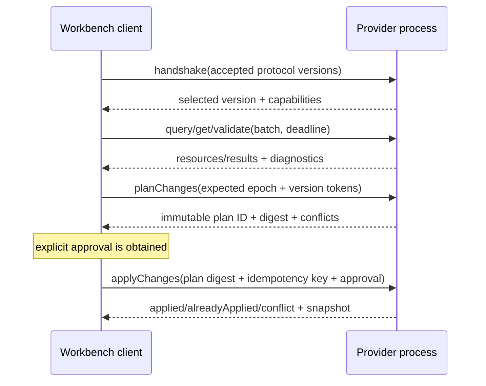

# ARC-WB-0009 - Provider-neutral resource authority

## Purpose

Describe the provider-neutral resource model, authority configuration, and
out-of-process protocol that satisfy
[`SPEC-WB-RESOURCE-PROVIDERS`](../../requirements/WB/SPEC-WB-RESOURCE-PROVIDERS.md)
while preserving the accepted
[`SPEC-001` declared-authority decision](../../../../PF-M0.4-workbench-specattest-authority-decision-package.md).

## Requirements Satisfied

- [`REQ-WB-PROVIDER-0001`](../../requirements/WB/SPEC-WB-RESOURCE-PROVIDERS.md)
- [`REQ-WB-PROVIDER-0002`](../../requirements/WB/SPEC-WB-RESOURCE-PROVIDERS.md)
- [`REQ-WB-PROVIDER-0003`](../../requirements/WB/SPEC-WB-RESOURCE-PROVIDERS.md)
- [`REQ-WB-PROVIDER-0004`](../../requirements/WB/SPEC-WB-RESOURCE-PROVIDERS.md)
- [`REQ-WB-PROVIDER-0005`](../../requirements/WB/SPEC-WB-RESOURCE-PROVIDERS.md)
- [`REQ-WB-PROVIDER-0006`](../../requirements/WB/SPEC-WB-RESOURCE-PROVIDERS.md)
- [`REQ-WB-PROVIDER-0007`](../../requirements/WB/SPEC-WB-RESOURCE-PROVIDERS.md)
- [`REQ-WB-PROVIDER-0008`](../../requirements/WB/SPEC-WB-RESOURCE-PROVIDERS.md)

## Vocabulary

| Term | Meaning | Authority consequence |
|---|---|---|
| Resource | One addressable item identified by resource type, resource set, and stable resource ID | Content is normative only when returned or committed by the set's declared authority |
| Provider | Independently versioned executable that implements the v1 provider protocol | Capability declaration does not grant authority; configuration grants one role |
| Authority | The only live provider allowed to write normative content for one resource type/set pair | No overlapping authority declaration or automatic failover |
| Projection | Read-only derived representation of an immutable snapshot | Carries source snapshot/digest/provenance and cannot be applied as normative content |
| Publication target | Provider allowed to receive explicit publication changes | Owns delivery state only; it never becomes authored-content authority |
| Snapshot | Immutable point-in-time resource collection with digest, authority declaration, compatibility pin, and provenance | Imported or derived snapshots set `authoritative=false`; exporting never transfers authority |
| Baseline | Immutable named pointer to an exact snapshot ID and payload digest | Supports review/comparison without creating another writer |
| Publication receipt | Immutable coordinate returned by an explicit publication apply | Retains source snapshot/digest and manifest digest; rendered delivery remains derived |

## Design Summary

The foundation has four layers:

1. `ResourceProvidersConfig` declares executable endpoints and exact
   resource-type/set authority bindings.
2. `ResourceAuthorityConfigurationValidator` fails closed before a process is
   started and resolves the configured role.
3. `ResourceProviderClient` exposes typed operations, validates handshake and
   capabilities, resolves configured provider identity/role/type/set, and
   enforces that scope plus batch limits.
4. `ProviderProcessTransport` and `ResourceProviderProtocolHost` exchange one
   versioned JSON envelope per line over stdin/stdout. First-party providers
   implement `IResourceProvider` and run the same host in their own process.

The wire contract is
[`resource-provider-protocol-v1.schema.json`](../../schemas/resource-provider-protocol-v1.schema.json).
The authority configuration contract is
[`resource-authority-config.schema.json`](../../schemas/resource-authority-config.schema.json).

## Authority configuration

Each binding is an exact tuple:

```text
(resourceType, resourceSet) ->
  authorityProvider: exactly one
  readOnlyEnrichers: zero or more
  publicationTargets: zero or more
  conflictPolicy: fail
  offlinePolicy: store-and-forward
```

Exact bindings avoid precedence ambiguity in the first release. Wildcards,
overlapping scopes, dual authority, latest-write-wins, field-level ownership,
and automatic authority failover are invalid. A provider ID may hold only one
role in a binding. Disabled or undeclared endpoints cannot hold a role.

## Protocol and lifecycle



`health` is also available before handshake for readiness checks. Every other
operation requires a successful handshake. Capabilities name supported
operations, resource types, roles, maximum batch size, atomic apply and
ordering behavior, and safety features.

## Mutation safety

Planning is read-only. Update, delete, and authority-transfer changes require
an expected resource version token; every plan names the expected authority
epoch. A returned plan must require explicit approval. Apply requires the exact
plan digest, same authority epoch, configured resource type/set, matching
body/envelope idempotency key, and an approver plus approval reference.

The contract distinguishes `applied`, `alreadyApplied`, `conflict`, and
`rejected`. Providers own durable idempotency storage, but Workbench prevents a
missing or mismatched key from reaching them. Read-only enrichers cannot plan
or apply. Publication targets may plan only `publish` changes.

## Snapshots, pins, provenance, and transfer

Every resource retains a payload SHA-256, optimistic-concurrency token,
optional compatibility pin, and provenance. A compatibility pin is generic:
contract, repository, edition, revision, schema path/digest,
canonicalization, and profile. This permits the deferred SpecAttest tuple to
be carried later without selecting or floating it now.

Snapshots retain the authority provider and epoch even when imported as
non-authoritative content. Projections name their source snapshot and digest.
Baselines point to an exact snapshot and digest and never become mutable
authority. Publication receipts retain the target provider, source snapshot
and payload digest, immutable publication manifest digest, permanent
reference, and provenance; rendered files and catalogs remain projections.
Authority-transfer records name old/new providers and epochs, immutable
source/target coordinates, payload digest, freeze time, explicit approver,
approval reference, and rollback window. The record enables an adapter to
implement the accepted freeze/export/validate/approve/commit/demote sequence;
the foundation does not perform a transfer automatically.

## Cancellation, timeouts, and process behavior

The client places an absolute deadline in every request and applies a local
timeout. The host derives a cancellation token from that deadline and passes
it through `IResourceProvider`. Transport timeout or caller cancellation
terminates the provider process tree, so an unresponsive process cannot remain
an ambiguous writer. A later retry must use the same idempotency coordinate
only when the payload is unchanged.

Processes launch with `UseShellExecute=false`; arguments are added through the
argument-list API. stdout is protocol-only. stderr is drained independently
and bounded before it is attached to a transport diagnostic.

## Existing provider compatibility

`IGithubProvider` and `IExecutionStateProvider` remain unchanged. Repositories
that omit `ResourceProviders` load an empty configuration and preserve current
behavior. Those abstractions may be wrapped by separately scoped provider
executables later, but the foundation neither changes their authority nor
pretends their in-process implementations satisfy the generic process
boundary.

## Data and State Considerations

- Provider configuration contains executable metadata, not credentials.
- The host is sequential in v1; provider batch operations are the concurrency
  and atomicity unit.
- Provider implementations durably own plan, idempotency, version-token, and
  apply state for their authority.
- Immutable store-and-forward snapshots/packages may outlive a provider
  session; they do not change authority while staged or unavailable.

## Edge Cases and Constraints

- Unknown protocol version, role, operation, or capability fails before
  mutation.
- Empty/oversized batches fail before provider dispatch.
- Expired deadlines return a retryable structured failure.
- Same ID with changed payload is a provider conflict, never a retry merge.
- Publication and projection state cannot be reclassified as normative
  content without an explicit new-draft or authority-transfer workflow.
- The deferred Standard tuple blocks SpecAttest interoperability claims but
  does not block this generic contract.

## Alternatives Considered

- In-process plugin DLLs: rejected because they share trust, dependency, and
  failure domains with Workbench.
- One universal provider with adapter-specific switches: rejected because it
  hides capabilities and authority boundaries.
- Automatic bidirectional synchronization: rejected by `SPEC-001` because it
  creates dual writers and ambiguous conflict resolution.
- Field-level ownership: rejected because an artifact would have multiple
  normative writers.
- HTTP-only providers: deferred; stdin/stdout gives local/offline providers a
  uniform contract without a resident service requirement.

## Risks

- Adapters can violate semantics internally; conformance suites and
  provider-specific verification remain required.
- Killing a timed-out provider cannot prove a remote side effect did not
  complete; idempotency query/retry behavior is therefore mandatory.
- Large payloads may require a future content-addressed side channel; v1 keeps
  a bounded batch contract and does not introduce one implicitly.

## Open Questions

- Whether a later protocol edition should support multiplexed requests.
- Whether content-addressed package references should become a standard body
  type after initial adapters establish size and security requirements.
